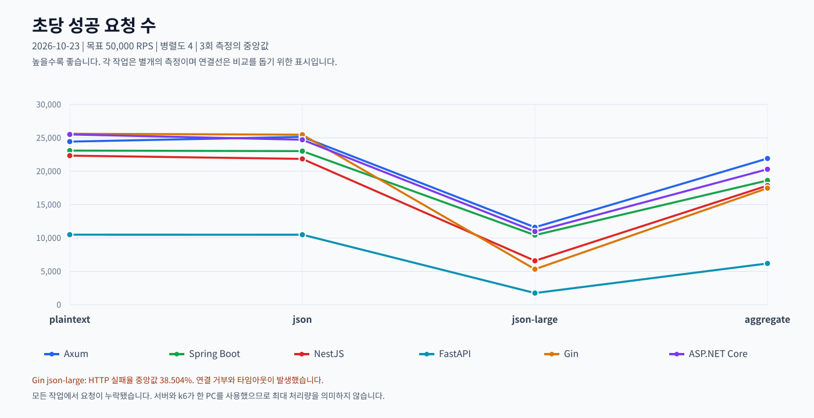
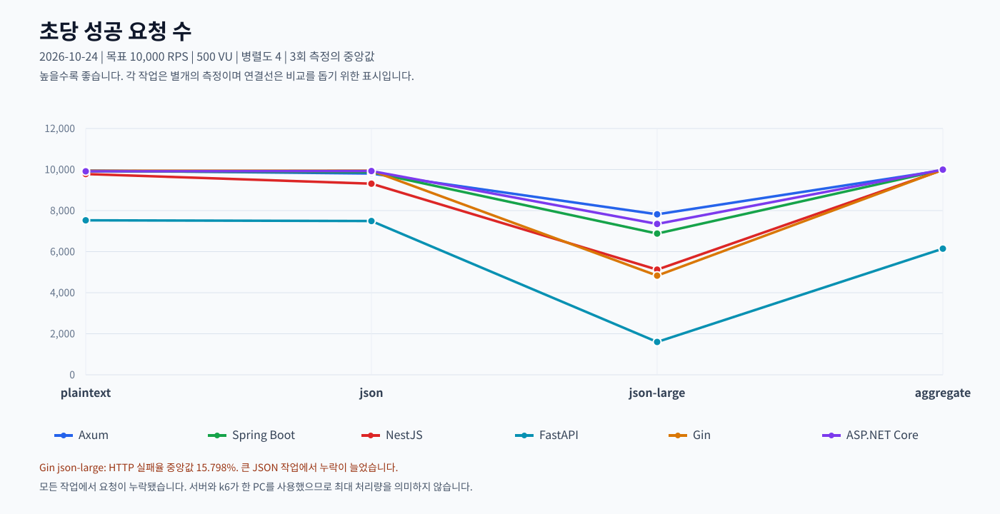

# Framework-bench

Axum, Spring Boot, NestJS, FastAPI, Gin, ASP.NET Core의 웹 서버 성능 비교 프로젝트입니다.

## 서버 구성 및 버전

| 서버 | 언어·런타임 | 프레임워크 | 주요 라이브러리 |
| --- | --- | --- | --- |
| Axum | Rust 1.99.1 | Axum 0.8.9 | Tokio 1.54.1, Serde 1.0.229, serde_json 1.0.154 (테스트), simd-json 0.18.1, sonic-rs 0.5.10 |
| Spring Boot | Java 25 LTS | Spring Boot 4.1.2, Spring MVC 7.0.10 | Tomcat 11.0.27, Jackson 3.1.7, Jackson Blackbird 3.1.7 |
| NestJS | Node.js 24.22.1 LTS, TypeScript 7.0.2 | NestJS 12.2.0, Express 5.3.0 | fast-json-stringify 7.1.3, RxJS 7.8.2, reflect-metadata 0.2.2 |
| FastAPI | Python 3.14.9 | FastAPI 0.161.1, Starlette 1.9.0 | Uvicorn 0.54.0, Pydantic 2.14.1, pydantic-core 2.50.1 |
| Gin | Go 1.27.3 이상 | Gin 1.12.0 | Go 표준 라이브러리 `encoding/json` |
| ASP.NET Core | .NET 10.0.13 LTS, C# 14 | ASP.NET Core 10.0.13, Kestrel 10.0.13 | System.Text.Json 10.0.13 (소스 생성) |

라이브러리 버전은 현재 잠금 파일 및 Spring Boot 빌드 기준입니다. Python은 공식 LTS가 없어 지원 중인 3.14 계열의 최신 유지보수 버전을 사용합니다.

## 실행

Windows PowerShell에서 저장소 루트 기준으로 실행합니다. 서버는 기본적으로 3000번 포트를 사용하므로 하나씩 실행하세요.
Gin을 실행하려면 [Go](https://go.dev/dl/) 1.27.3 이상이 PATH에 있어야 합니다. Go는 공식 LTS가 없어 최신 안정판을 사용합니다. 이 작업 환경에서는 `gin/.tools/go1.27.3/go/bin/go.exe`로도 실행할 수 있습니다.
ASP.NET Core는 [.NET SDK 10.0.402](https://dotnet.microsoft.com/download/dotnet/10.0)가 필요합니다. 이 작업 환경에서는 `aspnet/.tools/dotnet/dotnet.exe`를 사용할 수 있습니다.

```powershell
# Axum — Rust 1.99.1
cargo run --release --manifest-path axum/Cargo.toml

# Spring Boot — JDK 25, JAVA_HOME 설정 필요
.\spring-boot\gradlew.bat -p spring-boot build
java -jar spring-boot/build/libs/spring-boot-bench-0.1.0.jar

# NestJS — Node.js 24.22.1 LTS, 기본 워커 4개
npm --prefix nestjs ci
npm --prefix nestjs run build
npm --prefix nestjs start

# FastAPI — Python, Uvicorn 워커 4개
python -m venv fastapi/.venv
.\fastapi\.venv\Scripts\python.exe -m pip install -r fastapi/requirements.txt
.\fastapi\.venv\Scripts\python.exe -m uvicorn main:app --app-dir fastapi --host 0.0.0.0 --port 3000 --workers 4

# Gin — Go 1.27.3 이상
go -C gin run .

# ASP.NET Core — .NET SDK 10.0.402
Push-Location aspnet
dotnet run -c Release
Pop-Location
```

## 테스트 항목

| 경로 | 작업 |
| --- | --- |
| `GET /plaintext` | 짧은 문자열 응답 |
| `GET /json` | 작은 JSON 응답 |
| `GET /json-large` | 항목 1,000개의 JSON 응답 |
| `POST /aggregate` | 숫자 1,000개의 JSON을 받아 합계 등 계산 |

JSON 처리에는 Axum의 `sonic-rs`·`simd-json`, Spring Boot의 Jackson Blackbird, NestJS의 `fast-json-stringify`, FastAPI의 Pydantic, Gin의 `encoding/json`, ASP.NET Core의 `System.Text.Json`을 사용합니다. Axum은 테스트에 `serde_json`을 사용합니다.

## k6 측정

[k6를 설치](https://grafana.com/docs/k6/latest/set-up/install-k6/)하고 Axum 릴리스 빌드, Spring Boot JAR, NestJS 빌드와 FastAPI 가상 환경을 준비합니다. `JAVA_HOME`은 JDK 25로 설정하고 3000번 포트를 비워 둡니다.

```powershell
cargo build --release --manifest-path axum/Cargo.toml
.\spring-boot\gradlew.bat -p spring-boot build
npm --prefix nestjs run build
go -C gin build -buildvcs=false -o bin/framework-bench-gin.exe .
Push-Location aspnet
dotnet build -c Release
Pop-Location

# 여섯 서버를 차례로 측정: 병렬도 4, 50,000 RPS
.\benchmark\run-local.ps1 -Mode parallel -Rate 50000

# 작업자 1개로 측정
.\benchmark\run-local.ps1 -Mode single -Rate 50000

# Gin만 측정
.\benchmark\run-local.ps1 -Mode parallel -Rate 50000 -Servers gin
```

기본 설정은 작업별 워밍업 10초, 본 측정 20초 × 3회, 최대 VU 500개입니다. Axum과 Spring Boot는 작업 스레드, NestJS와 FastAPI는 워커 프로세스를 사용하며 Gin은 `GOMAXPROCS`로 병렬 실행 수를 지정합니다. ASP.NET Core는 `DOTNET_PROCESSOR_COUNT`로 런타임이 인식하는 프로세서 수를 지정하며 스레드 풀은 동적으로 관리합니다. 결과는 `benchmark/results/`에 저장됩니다.

## 측정 결과 (2026-10-23)

Windows에서 서버와 k6를 같은 PC에 두고 병렬도 4, 목표 **50,000 RPS**로 측정했습니다. 작업별 워밍업 10초 후 20초씩 3회 실행했으며, 각 값은 반복별 중앙값입니다. 성공 요청/초는 응답 검증을 통과한 본 측정 요청 기준입니다.



| 서버 | 작업 | 성공 요청/초 | p95 (ms) | p99 (ms) | HTTP 실패율 | 누락 |
| --- | --- | ---: | ---: | ---: | ---: | ---: |
| Axum | plaintext | 24,445.8 | 27.93 | 41.27 | 0.000% | 510,702 |
| Axum | json | 25,153.4 | 26.05 | 38.36 | 0.000% | 496,633 |
| Axum | json-large | 11,612.2 | 78.65 | 97.81 | 0.000% | 767,101 |
| Axum | aggregate | 21,910.0 | 30.93 | 41.89 | 0.000% | 561,035 |
| Spring Boot | plaintext | 23,091.5 | 27.96 | 41.09 | 0.000% | 537,549 |
| Spring Boot | json | 23,015.8 | 27.64 | 40.89 | 0.000% | 539,338 |
| Spring Boot | json-large | 10,434.6 | 73.75 | 88.28 | 0.000% | 790,769 |
| Spring Boot | aggregate | 18,625.7 | 34.68 | 45.43 | 0.000% | 627,075 |
| NestJS | plaintext | 22,336.4 | 29.36 | 42.25 | 0.000% | 552,946 |
| NestJS | json | 21,849.4 | 31.09 | 43.88 | 0.000% | 562,500 |
| NestJS | json-large | 6,591.3 | 92.84 | 109.07 | 0.000% | 867,660 |
| NestJS | aggregate | 17,852.1 | 40.92 | 55.62 | 0.000% | 642,200 |
| FastAPI | plaintext | 10,504.4 | 59.61 | 75.22 | 0.000% | 789,454 |
| FastAPI | json | 10,499.6 | 61.41 | 74.52 | 0.000% | 789,478 |
| FastAPI | json-large | 1,758.1 | 549.09 | 607.81 | 0.000% | 964,043 |
| FastAPI | aggregate | 6,190.0 | 133.56 | 149.75 | 0.000% | 875,512 |
| Gin | plaintext | 25,615.4 | 26.25 | 39.20 | 0.000% | 487,407 |
| Gin | json | 25,481.6 | 26.94 | 39.34 | 0.000% | 490,014 |
| Gin | json-large | 5,330.4 | 89.04 | 252.07 | 38.504% | 821,217 |
| Gin | aggregate | 17,466.7 | 46.27 | 55.92 | 0.000% | 649,964 |
| ASP.NET Core | plaintext | 25,510.3 | 26.44 | 38.25 | 0.000% | 488,816 |
| ASP.NET Core | json | 24,722.1 | 27.59 | 39.86 | 0.000% | 504,044 |
| ASP.NET Core | json-large | 10,974.5 | 68.00 | 81.00 | 0.000% | 779,881 |
| ASP.NET Core | aggregate | 20,308.1 | 33.13 | 43.00 | 0.000% | 593,431 |

모든 작업에서 요청이 누락되어 목표 50,000 RPS를 달성하지 못했습니다. 누락은 k6가 시작하지 못한 반복 수이며, HTTP 실패율은 전송한 본 측정 요청 기준입니다. 지연 시간에는 사전 검증 및 실패 요청이 포함됩니다. 서버와 k6가 자원을 공유하므로 서버의 최대 처리량으로 단정할 수 없습니다.

Gin의 json-large 측정에서는 연결 거부와 타임아웃이 발생했습니다. Spring Boot plaintext의 한 반복에서는 137건의 연결 실패가 발생했으나, 표의 HTTP 실패율은 세 반복의 중앙값입니다.

실행별 상세 결과는 `benchmark/results/20261023-201421-parallel-50000/`에 있습니다.

## 10,000 RPS / 500 VU 측정 (2026-10-24)

목표 **10,000 RPS**, 최대 **500 VU**, 병렬도 **4**로 작업별 워밍업 10초 후 20초씩 3회 측정했습니다. 아래 값은 반복별 중앙값이며, 성공 요청/초는 응답 검증을 통과한 본 측정 요청 기준입니다.



| 서버 | 작업 | 성공 요청/초 | p95 (ms) | p99 (ms) | HTTP 실패율 | 누락 |
| --- | --- | ---: | ---: | ---: | ---: | ---: |
| Axum | plaintext | 9,952.8 | 9.97 | 22.94 | 0.000% | 854 |
| Axum | json | 9,803.7 | 15.96 | 39.37 | 0.000% | 3,883 |
| Axum | json-large | 7,818.6 | 67.84 | 90.10 | 0.000% | 43,358 |
| Axum | aggregate | 9,960.8 | 2.99 | 9.28 | 0.000% | 656 |
| Spring Boot | plaintext | 9,916.2 | 13.67 | 28.43 | 0.000% | 1,473 |
| Spring Boot | json | 9,869.4 | 13.49 | 29.43 | 0.000% | 2,574 |
| Spring Boot | json-large | 6,878.8 | 93.87 | 118.16 | 0.000% | 62,166 |
| Spring Boot | aggregate | 9,987.9 | 3.99 | 8.98 | 0.000% | 207 |
| NestJS | plaintext | 9,781.1 | 24.60 | 39.91 | 0.000% | 4,338 |
| NestJS | json | 9,309.8 | 34.44 | 55.87 | 0.000% | 13,475 |
| NestJS | json-large | 5,125.1 | 130.42 | 146.91 | 0.000% | 97,029 |
| NestJS | aggregate | 9,984.3 | 4.99 | 11.97 | 0.000% | 269 |
| FastAPI | plaintext | 7,526.3 | 81.79 | 97.25 | 0.000% | 48,930 |
| FastAPI | json | 7,492.3 | 84.38 | 103.00 | 0.000% | 49,749 |
| FastAPI | json-large | 1,600.2 | 633.82 | 662.18 | 0.000% | 167,020 |
| FastAPI | aggregate | 6,145.9 | 108.23 | 121.90 | 0.000% | 76,540 |
| Gin | plaintext | 9,939.9 | 11.82 | 27.07 | 0.000% | 1,045 |
| Gin | json | 9,945.4 | 11.21 | 25.92 | 0.000% | 1,054 |
| Gin | json-large | 4,832.8 | 112.22 | 194.89 | 15.798% | 84,662 |
| Gin | aggregate | 9,990.0 | 5.00 | 12.32 | 0.000% | 130 |
| ASP.NET Core | plaintext | 9,911.8 | 13.96 | 27.93 | 0.000% | 1,684 |
| ASP.NET Core | json | 9,925.8 | 13.47 | 27.44 | 0.000% | 1,446 |
| ASP.NET Core | json-large | 7,349.3 | 80.78 | 98.74 | 0.000% | 52,713 |
| ASP.NET Core | aggregate | 9,997.4 | 3.99 | 8.98 | 0.000% | 0 |

`plaintext`, `json`, `aggregate`는 대체로 목표 요청률에 근접했습니다. 큰 JSON은 모든 서버에서 누락이 늘었으며, Gin `json-large`는 HTTP 실패율 중앙값 15.798%를 기록했습니다. 실행별 상세 결과는 `benchmark/results/20261024-031102-parallel-10000/`에 있습니다.
